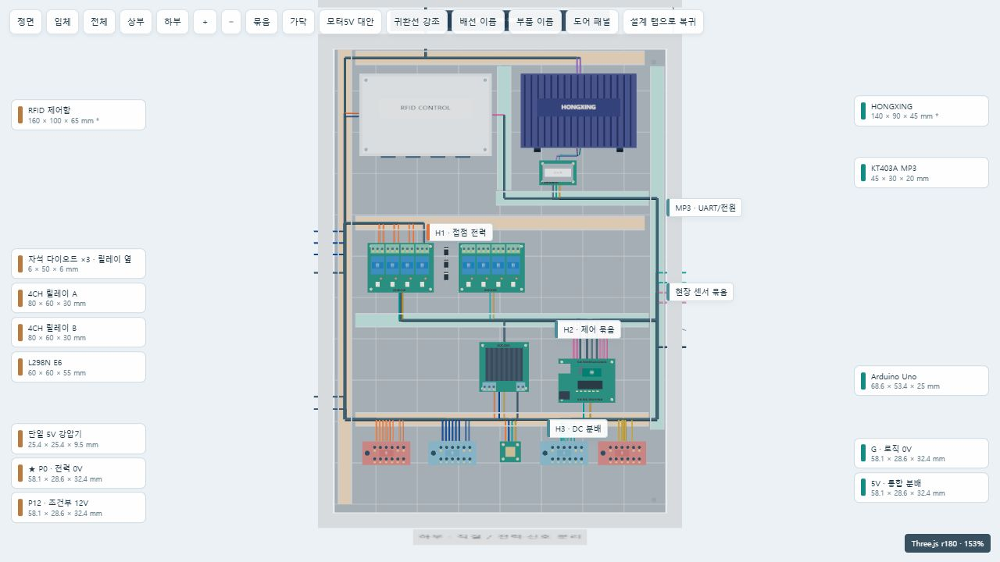

# MONG SHOT 배전함 재설계

몽샷은 센서 입력에 따라 조명, 모터, 전자석을 순서대로 제어하는 Arduino 기반 퍼즐 장치입니다. 기존 장치의 동작 순서를 유지하면서 전원과 제어 배선을 단자까지 추적할 수 있도록 배전함의 부품 배치와 배선 경로를 다시 설계했습니다.

## 전원과 제어선 배치

전선이 지나갈 덕트를 먼저 정하고 각 부품의 단자가 가까운 덕트를 향하도록 배치했습니다. 예를 들어 릴레이의 전력 접점은 위쪽 덕트를, Arduino에 연결되는 제어 단자는 아래쪽 덕트를 향합니다. 5 V 전원은 기존 강압기 한 대에서 분배하도록 정리했습니다.

2D 배선도와 3D 뷰어가 같은 경로 데이터를 사용합니다. 선을 선택하면 묶음에 들어 있는 가닥과 양쪽 연결 단자를 확인할 수 있습니다.

## 뷰어 열기

저장소를 내려받고 `simulation/index.html`을 브라우저에서 엽니다. Windows에서는 저장소 루트의 `OPEN_MONGSHOT.cmd`를 실행해도 됩니다. 화면 오른쪽 위의 **v5.3 보존본**을 선택하면 이전 배치와 Arduino 시뮬레이터를 볼 수 있습니다.

## 설계 자료

- [정면 배선도](hardware/v6/front-wiring.svg) · [전체 결선표](hardware/v6/wire-segments.csv) · [부품표](hardware/v6/product-bom.csv)
- [전원과 모듈 배치](docs/12-v6-common-star.md) · [하네스 조립 순서](docs/13-harness-assembly.md)
- [v5.3 보존 자료](archive/v5.3-preserved/README.md)

설계 데이터를 수정한 뒤에는 `python tools/build_project.py`로 뷰어를 다시 만들고 `python tests/check-design.py`로 검사합니다.

## 검증 범위

[배선 모델 검사](tests/v61-harness-verification.json)에서 덕트 경로와 단자 앞 노출 선 길이를 확인했습니다. 센서 단계와 LED·버튼 반응은 [Arduino 시뮬레이션](archive/v5.3-preserved/docs/05-firmware-and-verification.md)으로 확인했습니다.

배전함 치수는 사진을 바탕으로 추정했습니다. 실제 치수, 부하 전류, 설치 후 동작은 현장에서 확인해야 합니다.
